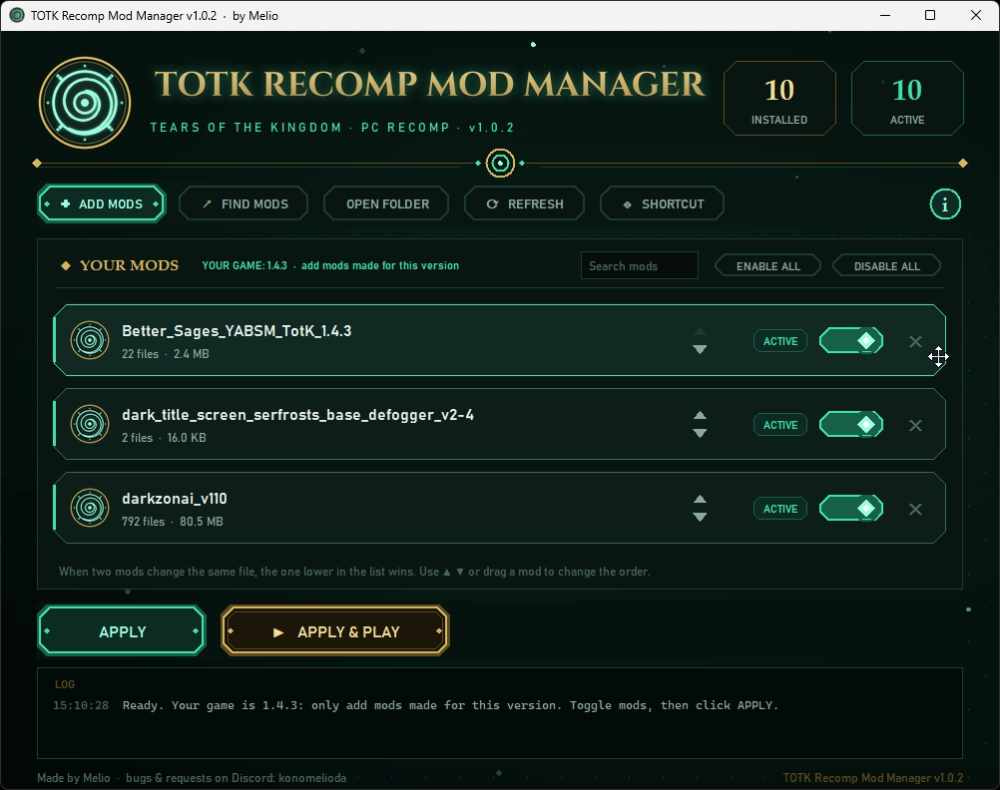

# TOTK Recomp Mod Manager

A mod manager for **[totk-pc-recomp](https://github.com/valentderah/totk-pc-recomp)** (The Legend of Zelda: Tears of the Kingdom, PC recompilation), for **Windows** and **Linux** (Steam Deck / Steam Machine included).
Add mods from `.zip`, `.7z` or `.rar` files, switch them on and off, choose which one wins, and apply them with one click. No command line needed.

Made by **Melio**. Bugs and requests: [Issues](../../issues) or Discord **konomelioda**.

## Features

- Import RomFS mods from `.zip`, `.7z` or `.rar` files, with **ADD MODS** or by dropping them on the window.
  The **ⓘ** button explains which mods work.
- **FIND MODS** opens the Tears of the Kingdom mods on GameBanana.
- Enable or disable each mod with a switch, or all of them at once with **ENABLE ALL** / **DISABLE ALL**.
- Choose the priority order with the ▲ ▼ arrows or by dragging a mod: when two mods change the same file, the one
  lower in the list wins.
- Shows a red **CONFLICTS** badge on mods that change the same files as another enabled mod. Click it to see which
  mods and which one wins.
- Search your mods by name.
- Click **APPLY**, or **APPLY & PLAY** to start the game right after.
- Detects your game version and warns when a mod was made for another version.
- Writes the `manifest.tsv` the recomp requires, patches the resource size table for the mods and updates `totk.ini`.
- Never modifies `romfs.bin`: disable every mod and click APPLY to go back to the vanilla game.
- **SHORTCUT** button: a desktop shortcut on Windows, an app menu entry (and desktop icon) on Linux.
- Tells you when a new version of the Mod Manager is out.

## Install

### Windows

1. Download `TOTKRecompModManager.exe` from the [Releases](../../releases) page.
2. Put it in your game folder, next to `totk.exe`.
3. Double-click it.

> Windows Defender may flag the `.exe` (a known false positive with PyInstaller builds). You can [run from source](#run-from-source) instead.

### Linux, Steam Deck, Steam Machine

1. Download `TOTKRecompModManager.AppImage` from the [Releases](../../releases) page.
2. Put it in your game folder (the folder you picked in the recomp setup).
3. Make it executable: right-click it › Properties › Permissions › *Is executable*, or run `chmod +x TOTKRecompModManager.AppImage`.
4. Double-click it. On a Steam Deck or Steam Machine, do this in **Desktop Mode**.
5. Click **SHORTCUT** once: the Mod Manager gets its icon in your app menu and on your desktop (and can be added to Steam
   from there). Tools like Gear Lever or AppImageLauncher can also add the AppImage to your menu.

> Linux support is new: if something does not work, please open an [issue](../../issues).
> If the file does not start (older distributions), [run from source](#run-from-source) instead.

## How to use

1. Click **ADD MODS** and pick one or more mods (`.zip`, `.7z`, `.rar`), or drop them on the window.
2. Turn mods on or off with their switch, or use **ENABLE ALL** / **DISABLE ALL** (while searching, they only change the mods found).
3. If a mod shows a red **CONFLICTS** badge, click it to see the other mod, then use ▲ ▼ or drag the mod you prefer
   lower in the list.
4. Click **APPLY** (or **APPLY & PLAY**). Changes are only installed when you apply them.

Your mods are stored in the `mods-sources` folder next to the game (**OPEN FOLDER** opens it).

## Which mods work?

For now, only **RomFS mods** are supported: the mod's archive must contain a `romfs` folder.

| Mod | Works? | Why |
|---|---|---|
| `romfs` folder only | ✓ Yes | Game files (models, textures, text...) that the recomp reads instead of the original ones. |
| `romfs` + an `exefs` folder with only `.ips` files | ◐ The romfs part | The romfs part is installed, the patch is never applied: it changes bytes of the Switch game code, which the recomp has already rebuilt for PC (and it only starts if the original code is untouched). |
| `exefs` folder with other files (code modules) | ✕ No | They add Switch code that runs next to the game. The recomp only runs the game rebuilt for PC and loads no extra module, so that code never runs. |

Frame rate, game resolution and ultrawide interface do not need code mods: the recomp has them in `totk.ini`
(`fps_limit`, `output_res`, and the `romfs-patches-<resolution>` folders).

## Important: use mods made for your game version

Mods replace game files. A mod made for another version of the game (for example 1.2.1 when your game is 1.4.3)
can ship outdated files and crash the game. The manager shows **YOUR GAME: x.y.z** at the top of the list:
only add mods made for that version.

## Troubleshooting

| Problem | Fix |
|---|---|
| `romfs-index.bin not found` | The Mod Manager is not in the game folder. Move it next to the game. |
| `no romfs folder inside` | The zip is not a RomFS mod. See [Which mods work?](#which-mods-work) |
| The game crashes after adding a mod | The mod is probably made for another game version. Disable it and click APPLY. |
| `could not open the .rar` | On Linux, install `bsdtar` (package `libarchive-tools` or `libarchive`), `unrar` or `7z`. Or extract the mod and zip it. |
| Go back to the vanilla game | **DISABLE ALL**, then **APPLY**. |

## Run from source

Needs Python 3.14, or an older Python 3 with the `zstandard` package
(`py -m pip install zstandard` on Windows, `python3 -m pip install zstandard` on Linux).
On Linux, tkinter may be a separate package (Debian/Ubuntu: `sudo apt install python3-tk`).

Optional packages: `tkinterdnd2` (drag and drop), `py7zr` (`.7z` mods), `certifi` (update check on some Linux systems).
Without them, the rest works.

Put `TOTK Recomp Mod Manager.pyw`, `install_mods.py` and the `mm_assets` folder in the game folder, then
double-click the `.pyw` (Windows) or run `python3 "TOTK Recomp Mod Manager.pyw"` (Linux).

## Build

Put this folder inside the game folder, then:

- **Windows:** run `build_exe.bat`. It writes `TOTKRecompModManager.exe` one level up.
- **Linux:** run `sh build_linux.sh` (needs `python3-tk`, `python3-venv` and `curl`). It writes `TOTKRecompModManager.AppImage` one level up.

## Files

| File | Role |
|---|---|
| `TOTK Recomp Mod Manager.pyw` | The window (tkinter) |
| `install_mods.py` | Installs the enabled mods (also works on its own: `py install_mods.py` or `python3 install_mods.py`) |
| `mm_assets/` | Icon and artwork (original, no game assets) |
| `build_exe.bat` | Builds `TOTKRecompModManager.exe` (Windows) |
| `build_linux.sh` | Builds `TOTKRecompModManager.AppImage` (Linux) |

## Releases

Tag each release `vX.Y.Z` (for example `v1.0.3`): the Mod Manager compares that tag with its own version to tell
users an update is out.

## Changelog

**v1.0.2**
- Linux support (Steam Deck and Steam Machine included).
- Priority order with ▲ ▼ or drag and drop (it used to be A→Z order), and red conflict badges.
- `.7z` and `.rar` mods, and drag and drop.
- **FIND MODS** button, search, and update notice.
- **ENABLE ALL** / **DISABLE ALL** buttons.
- Disabled mods now show **DISABLED**.
- New **ⓘ** button that explains which mods work, and clearer warnings for mods with an `exefs` folder.
- The title now reads **TOTK Recomp Mod Manager**.
- Mods whose `romfs` folder has another letter case (`RomFS`, `Romfs`) are now found on every system.

## Credits

The title font is [Cinzel](https://fonts.google.com/specimen/Cinzel) (SIL Open Font License), rendered into `mm_assets/title.png`.
Not affiliated with Nintendo. Tears of the Kingdom is a trademark of Nintendo.
